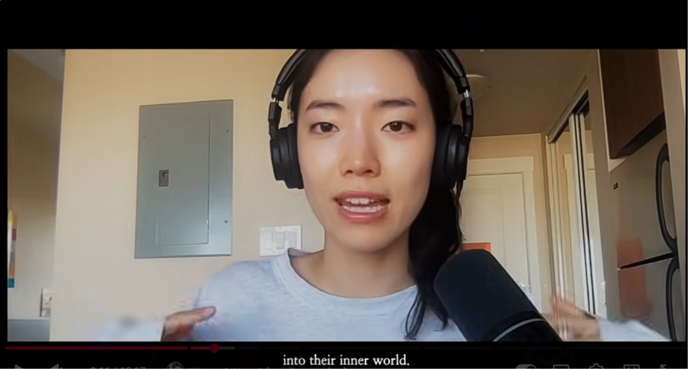
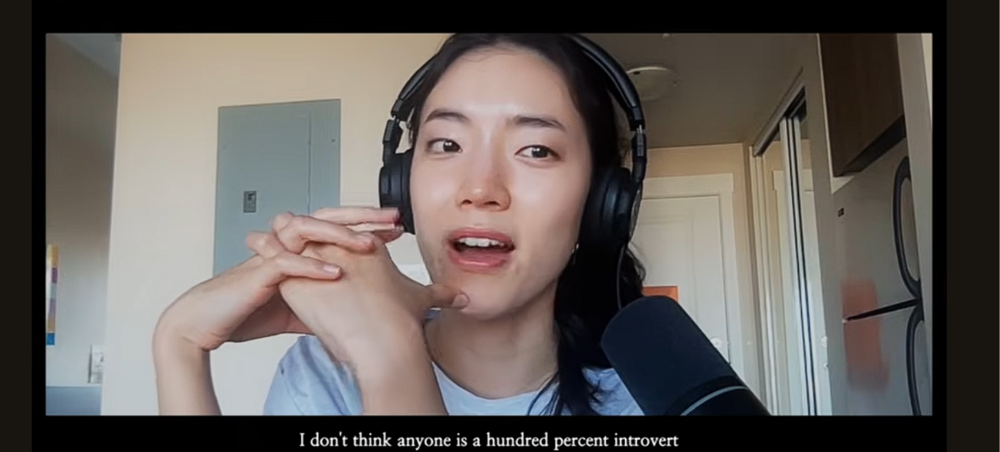

##  By chance

When I'm cooking, as normal I play youtube. Randomly, I saw this video, she said that she had ever heard a definition about introvert person is a person who put more their attention and energy into their inner world.

[why quiet people are so attractive (an introvert’s story)](https://youtu.be/n2aOC0vOwLg?si=GTK9A2pDMYz-z0fD)
She said she was kind of person who could pull out a lot of energy for a short time, give it to all people, and then she was completely drained.

I see myself in her story, when I talk to someone I have to use 100% of my brain ability to think what should I say to them, and sometime my story could be awkward =)). I often live in my head and I have a millon thoughts running through in my head.

I think the same way as her, no one is one hundered percent is extrovert or introvert. By the way, her voice is easy on the ears, I will see this channel more to improve my english. It is also a reason I start write this blog.
Good bye, see you soon >.<
